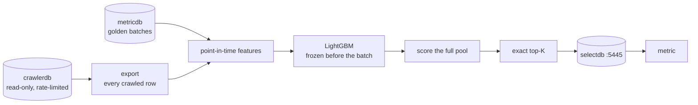

# IndexSelectionV2

IndexSelectionV2 picks the 128,000,000 crawled URLs that go into the search index.
It learns which pages tend to become golden URLs, scores every crawled page, and
publishes the exact top K to its own selectdb. The official metric reads that list
with its existing query.

- Design: [`docs/DESIGN.md`](docs/DESIGN.md)
- Backtest and full-scale results: [`docs/BENCHMARK.md`](docs/BENCHMARK.md)
- Recrawl of the list (not deployed): [`docs/RECRAWL.md`](docs/RECRAWL.md)
- Text index and its trial (not deployed): [`docs/TEXT_INDEX.md`](docs/TEXT_INDEX.md)

## How the metric reads the list

The metric does not change. It runs the same query against a different port:

```sql
-- role select, database selectdb, 172.16.191.1:5445
SELECT url FROM public.selected_urls_current WHERE url = ANY(:urls)
```

`public.selected_urls_current` keeps the v1 columns (`url`, `score`, `first_seen`,
`run_id`, `selected_at`). A golden URL counts as indexed when its canonical spelling
is in the table (WebSearchEngine #7).

## Pipeline



| Step | Command | Reads | Writes |
|---|---|---|---|
| Export | `pull-golden`, `pull-dims`, `pull-full` | metricdb, crawlerdb (read-only) | Parquet in the work dir |
| Sample | `derive-sample`, `derive-positives` | the export | 2 % hash sample, golden rows |
| Model | `backtest`, `train` | the sample | backtest report, frozen model |
| Select | `score-full`, `select-full` | the export, the model | the 128M-URL manifest |
| Publish | `migrate-selectdb`, `publish`, `swap`, `verify-live` | the manifest | selectdb :5445 only |

## What it never does

- It never writes crawlerdb, metricdb or the v1 selectdb (`:5444`). Every session to
  crawlerdb and metricdb is read-only on the server and behind a client-side SQL gate.
- It never reads crawlerdb during the measurement days (1st and 16th, 00:00–20:00 UTC)
  or in each hour's :58–:10 window, when the metric scans the crawl tables.
- It never swaps the list on the 1st and 16th between 11:30 and 20:00 UTC, so the head
  and random sets of one batch see the same list.
- It has no scheduler. Each command is one container run, except the two opt-in recrawl
  services below.
- It never writes `/data/ipc` or `/data/manual_bulk_crawls`. The recrawl talks to the
  crawler only over its HTTP API.

## Recrawl (not deployed)

The list needs page text to build an inverted index, but `crawl_result` keeps HTML for
only 8 hours and the crawler never re-fetches a page. `recrawl.py` re-fetches the list
through the crawler's bulk crawl v2 API (WebCrawler `bulk-crawl-v2`). The crawler
schedules the fetches; isel keeps no database for it, only files with one writer each:

| Command | Does |
|---|---|
| `recrawl-push` | loop: computes the live list's due docs from the manifest and the outcome files, and sends them by rank in batches of 10,000 until the API answers 503 |
| `recrawl-pull` | loop: downloads the crawler's result segments, keeps the extracted text as Parquet and one outcome row per URL, then acks the segments |
| `recrawl-compact` | merges old outcome and text files, so each doc keeps what `due_query` and the text index read |
| `recrawl-report` | progress of the live list, from the outcome files and the crawler's counts |

The two loops run only with `--profile recrawl`, and only after the crawler serves the
v2 API. `tests/recrawl_fakes.py` serves that contract over HTTP; the tests run push,
pull and compact against it.

## Text index (not deployed)

The recrawl text is what the metric's `ranked_rate` needs: Recall@10 of our search on
the golden keywords. `textindex.py` indexes it in OpenSearch with ICU analysis:

| Command | Does |
|---|---|
| `text-index-build` | loads the newest text of each doc into a new index, checks the count, merges it, blocks writes, then moves the alias `isel-text` to it in one call; refuses to start or to merge if the disk would pass the flood stage; keeps the previous index for rollback if `keep_prev` is set |
| `text-index-eval --batch N` | searches each golden keyword of batch N and reports Recall@10 over (keyword, golden URL) pairs, as the metric's old rank code counted, and over distinct URLs |

`deploy/compose.opensearch.yaml` runs a local node; `pytest -m opensearch` starts a node
from its image. On Host2, `deploy/compose.compute.yaml` runs the node (profile `search`)
and both commands (service `text-index`); the steps are in TEXT_INDEX.md, "Before Host2".

## Rollout and rollback

| Step | Who | Undo |
|---|---|---|
| Publish and swap a list on :5445 | us | `rollback` restores the previous list at once |
| Point the metric's `--select_db_url` at :5445 | TA (Dockerfile cron) | set it back to `:5444` |

## Code arrives in these pull requests

| Part | Adds |
|---|---|
| 1 | this README and the benchmark |
| 2 | package, strict config loader, URL rules |
| 3 | read-only crawlerdb and metricdb access, full export |
| 4 | point-in-time features, hash sample |
| 5 | model training, backtest, manifest |
| 6 | full scoring, exact top-K |
| 7 | selectdb schema, publish, swap, rollback, verify-live |
| 8 | container image, compose files, runbook |
| 9 | recrawl client (files only), crawler API v2 client, text extraction (not deployed) |
| 10 | text index: OpenSearch build, golden Recall@10 eval, engine trial (not deployed) |
