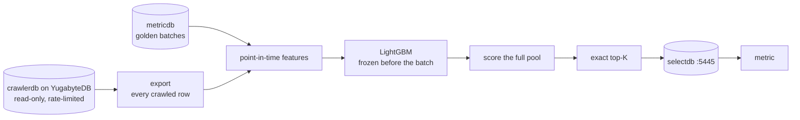

# IndexSelectionV2

IndexSelectionV2 picks the 64,000,000 crawled URLs that go into the search index.
It learns which pages tend to become golden URLs, scores every crawled page, and
publishes the exact top K to its own selectdb. The official metric reads that list
with its existing query.

- Design: [`docs/DESIGN.md`](docs/DESIGN.md)
- Backtest and full-scale results: [`docs/BENCHMARK.md`](docs/BENCHMARK.md)
- Recrawl of the list (not deployed): [`docs/RECRAWL.md`](docs/RECRAWL.md)
- Text index and its trial (not deployed): [`docs/TEXT_INDEX.md`](docs/TEXT_INDEX.md)

## How the metric reads the list

The metric does not change. It runs the same query against a different port:

```sql
-- role select, database selectdb, 172.16.191.1:5445
SELECT url FROM public.selected_urls_current WHERE url = ANY(:urls)
```

`public.selected_urls_current` keeps the v1 columns (`url`, `score`, `first_seen`,
`run_id`, `selected_at`). A golden URL counts as indexed when its canonical spelling
is in the table (WebSearchEngine #7).

## Pipeline



| Step | Command | Reads | Writes |
|---|---|---|---|
| Export | `pull-golden`, `pull-dims`, `pull-full` | metricdb, crawlerdb on YugabyteDB (read-only) | Parquet in the work dir |
| Sample | `derive-sample`, `derive-positives` | the export | 2 % hash sample, golden rows |
| Model | `backtest`, `train` | the sample | backtest report, frozen model |
| Select | `score-full`, `select-full` | the export, the model | the 64M-URL manifest |
| Publish | `migrate-selectdb`, `publish`, `swap`, `verify-live` | the manifest | selectdb :5445 only |
| Refresh | `refresh --loop` (service), `refresh --status` | all of the above | a new live list before every golden day, then `recrawl-sync` |

The opt-in `refresh` service runs these steps for every golden day (the 1st and 16th).
It gates the new list against the live one before `publish` and swaps it before the
metric reads it ([`docs/DESIGN.md`](docs/DESIGN.md) §11). Every other command is one
container run, except the two opt-in recrawl services below.

## What it never does

- It never writes crawlerdb, metricdb or the v1 selectdb (`:5444`). Every session to
  crawlerdb and metricdb is read-only on the server and behind a client-side SQL gate.
- It never reads crawlerdb during the measurement days (1st and 16th, 00:00–20:00 UTC)
  or in each hour's :58–:10 window, when the metric scans the crawl tables.
- It never swaps the list on the 1st and 16th between 11:30 and 20:00 UTC, so the head
  and random sets of one batch see the same list.
- The `refresh` service never publishes a list that failed its gates, and never rebuilds
  the text index.
- It never writes `/data/ipc` or `/data/manual_bulk_crawls`. Recrawl jobs go through the
  crawler's API, the crawler's result files are read-only for us, and we delete them
  through the same API.

## Recrawl (not deployed)

The list needs page text to build an inverted index, but `crawl_result` keeps HTML for
only 8 hours and the crawler never re-fetches a page. `recrawl.py` re-fetches the list
through the manual bulk crawl API of NTU-CSIE5376/WebCrawler#84 as Host2 runs it
(`cc96500` code): isel sets no rate, and the crawler's AutoThrottle paces every host.

| Command | Does |
|---|---|
| `recrawl-sync` | loads the live run into the `recrawl` schema of selectdb (one row per host and per doc) |
| `recrawl-plan` | loop: packs due docs of the best-ranked hosts into jobs of up to 10,000 URLs (at most 240 per hostname) and sends them to `POST /v1/manual-bulk-crawls` with `ttl_days: 3`; polls each job's status with `GET` until it is `completed`; deletes each applied job with `DELETE` |
| `recrawl-archive` | loop: reads each completed `results/{job_id}/` read-only, one `crawler_NN/` partition per crawler, keeps the extracted text as Parquet under `/data/isel/text`, and updates the frontier |

The two loops run only with `--profile recrawl`. Their sizes are the API's limits:
10,000 URLs per job and 64 jobs at the crawler (`docs/RECRAWL.md` §11).
`tests/recrawl_fakes.py` holds a stub of that API and a fake crawler that
writes per-crawler partitions the way #84 does; the integration tests run the whole loop
against them.

## Text index (not deployed)

The recrawl text is what the metric's `ranked_rate` needs: Recall@10 of our search on
the golden keywords. `textindex.py` indexes it in OpenSearch with ICU analysis:

| Command | Does |
|---|---|
| `text-index-build` | loads the newest text of each doc into a new index, checks the count, merges it, blocks writes, then moves the alias `isel-text` to it in one call; refuses to start or to merge if the disk would pass the flood stage; keeps the previous index for rollback if `keep_prev` is set |
| `text-index-eval --batch N` | searches each golden keyword of batch N and reports Recall@10 over (keyword, golden URL) pairs, as the metric's old rank code counted, and over distinct URLs |

`deploy/compose.opensearch.yaml` runs a local node; `pytest -m opensearch` starts a node
from its image. On Host2, `deploy/compose.compute.yaml` runs the node (profile `search`)
and both commands (service `text-index`); the steps are in TEXT_INDEX.md, "Before Host2".

## Rollout and rollback

| Step | Who | Undo |
|---|---|---|
| Publish and swap a list on :5445 | us | `rollback` restores the previous list at once |
| Refresh the list every golden day (`refresh` service) | us | stop `refresh`, then `rollback` and `recrawl-sync` |
| Point the metric's `--select_db_url` at :5445 | TA (Dockerfile cron) | set it back to `:5444` |

## Code arrives in these pull requests

| Part | Adds |
|---|---|
| 1 | this README and the benchmark |
| 2 | package, strict config loader, URL rules |
| 3 | read-only crawlerdb and metricdb access, full export |
| 4 | point-in-time features, hash sample |
| 5 | model training, backtest, manifest |
| 6 | full scoring, exact top-K |
| 7 | selectdb schema, publish, swap, rollback, verify-live |
| 8 | container image, compose files, runbook |
| 9 | recrawl frontier, crawler API client, text extraction (not deployed) |
| 10 | text index: OpenSearch build, golden Recall@10 eval, engine trial (not deployed) |
