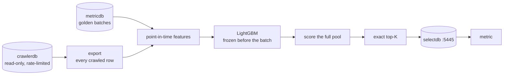

# IndexSelectionV2

IndexSelectionV2 picks the 128,000,000 crawled URLs that go into the search index.
It learns which pages tend to become golden URLs, scores every crawled page, and
publishes the exact top K to its own selectdb. The official metric reads that list
with its existing query.

- Design: [`docs/DESIGN.md`](docs/DESIGN.md)
- Backtest and full-scale results: [`docs/BENCHMARK.md`](docs/BENCHMARK.md)

## How the metric reads the list

The metric does not change. It runs the same query against a different port:

```sql
-- role select, database selectdb, 172.16.191.1:5445
SELECT url FROM public.selected_urls_current WHERE url = ANY(:urls)
```

`public.selected_urls_current` keeps the v1 columns (`url`, `score`, `first_seen`,
`run_id`, `selected_at`). A golden URL counts as indexed when its canonical spelling
is in the table (WebSearchEngine #7).

## Pipeline



| Step | Command | Reads | Writes |
|---|---|---|---|
| Export | `pull-golden`, `pull-dims`, `pull-full` | metricdb, crawlerdb (read-only) | Parquet in the work dir |
| Sample | `derive-sample`, `derive-positives` | the export | 2 % hash sample, golden rows |
| Model | `backtest`, `train` | the sample | backtest report, frozen model |
| Select | `score-full`, `select-full` | the export, the model | the 128M-URL manifest |
| Publish | `migrate-selectdb`, `publish`, `swap`, `verify-live` | the manifest | selectdb :5445 only |

## What it never does

- It never writes crawlerdb, metricdb or the v1 selectdb (`:5444`). Every session to
  crawlerdb and metricdb is read-only on the server and behind a client-side SQL gate.
- It never reads crawlerdb during the measurement days (1st and 16th, 00:00–20:00 UTC)
  or in each hour's :58–:10 window, when the metric scans the crawl tables.
- It never swaps the list on the 1st and 16th between 11:30 and 20:00 UTC, so the head
  and random sets of one batch see the same list.
- It has no scheduler and no daemon. Each command is one container run.

## Rollout and rollback

| Step | Who | Undo |
|---|---|---|
| Publish and swap a list on :5445 | us | `rollback` restores the previous list at once |
| Point the metric's `--select_db_url` at :5445 | TA (Dockerfile cron) | set it back to `:5444` |

## Code arrives in these pull requests

| Part | Adds |
|---|---|
| 1 | this README and the benchmark |
| 2 | package, strict config loader, URL rules |
| 3 | read-only crawlerdb and metricdb access, full export |
| 4 | point-in-time features, hash sample |
| 5 | model training, backtest, manifest |
| 6 | full scoring, exact top-K |
| 7 | selectdb schema, publish, swap, rollback, verify-live |
| 8 | container image, compose files, runbook |
