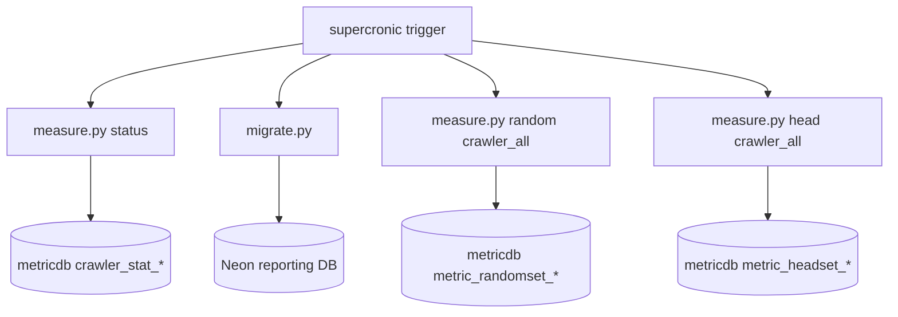

# Dockerfile and Runtime Operations - Full Technical Document

## 1. Container Build Design

Base image:

- `ubuntu:24.04`

Installed packages:

- `git`, `python3`, `python3-pip`, `python3-venv`, `curl`, `vim`
- [supercronic](https://github.com/aptible/supercronic) v0.2.51 (amd64), checked against its release SHA1

Project layout in container:

- Code copied to `/root/WebSearchEngine`
- Virtualenv at `/root/system-venv`
- Dependencies installed from `/root/WebSearchEngine/Metric/requirments.txt`
- Schedule at `/etc/supercronic/crontab`, copied from `Metric/deploy/crontab`. `supercronic -test` runs at build time, so a bad crontab fails the build.

## 2. Runtime Environment

- The image holds no secret. `SERPAPI_KEY` comes from `metric.env` at run time (`env_file` in `docker-compose.yml`). The file is `chmod 600` and kept out of git and the build context.
- supercronic does not clear the environment, so every job sees `SERPAPI_KEY`. Classic cron did: it gave jobs only `/etc/environment`, which held the Dockerfile's placeholder key, and batch 22 (2026-11-16) came out empty.
- `Metric/Query/SerpApi.py` reads the key, and so does the course runner's quota check (section 8).
- `TZ=UTC`: the schedules below are UTC.

## 3. Scheduled Jobs

`METRIC_CRONTAB` picks the file in `/etc/supercronic/`. The default, `Metric/deploy/crontab`, holds the jobs below; `crontab.course-202612` replaces its golden jobs with the course runner (section 8).

- Hourly at minute 0:
  - `measure.py --test --measure status`
  - `migrate.py`

- Monthly on day 1 and 16 at 12:00:
  - `measure.py --create --strategy random --keywordNums 1000 --test --measure crawler_all`

- Monthly on day 1 and 16 at 18:00:
  - `measure.py --create --strategy head --keywordNums 1000 --test --measure crawler_all`

A `--create` run first checks the key and quota for free (`account.json`). A bad key or a trending fetch that fails for any geo makes the job exit non-zero and writes no batch. See [01-measure-py.md](./01-measure-py.md) 3.2.

## 4. Runtime Process Model

- `CMD ["supercronic", "-split-logs", "/etc/supercronic/crontab"]`: supercronic is PID 1.
- Job output and job failures, with their exit status, go to `docker logs metric`. The json-file log keeps 5 files of 50 MB.
- A job does not start again while its previous run is still going.
- On SIGTERM supercronic waits for running jobs. `stop_grace_period: 30m` gives a golden job time to finish.

## 5. Compose Services

`docker-compose.yml` defines `metric` (above: `network_mode: host`, `restart: unless-stopped`) and `metric_postgres`:

- Image: `postgres:16`
- User/password/db: `metric/metric/metricdb`
- Port mapping: `5433:5432`
- Data volume: `/data/metric:/var/lib/postgresql/data`

## 6. Operations Diagram



## 7. Deploy and Rollback (Host1)

Run from the WebSearchEngine clone on Host1. Avoid minute :00 of any hour, and 12:00–20:00 UTC on the 1st and 16th. While the course schedule runs (section 8), avoid 00:00–12:00 UTC on Dec 1, 8 and 15 instead, and follow section 8 first.

1. `git pull` to the commit to deploy.
2. Write the key once: `metric.env` with one line `SERPAPI_KEY=<key>`, then `chmod 600 metric.env`.
3. Build, and check the key and quota. This costs no search:
   ```bash
   METRIC_TAG=$(git rev-parse --short HEAD) docker compose build metric
   METRIC_TAG=$(git rev-parse --short HEAD) docker compose run --rm metric \
     sh -c 'cd /root/WebSearchEngine && /root/system-venv/bin/python3 Metric/getQuota.py'
   ```
4. Replace the running container. Keep the old one for rollback:
   ```bash
   docker stop metric && docker rename metric metric-prev
   METRIC_TAG=$(git rev-parse --short HEAD) docker compose up -d metric
   ```
5. Check: after the next full hour, `docker logs metric` shows the status job with `job succeeded`, and no `level=error` line. Before step 4, `docker compose run --rm metric sh /root/WebSearchEngine/Metric/deploy/check-cron.sh` checks the schedule the new container will run; it spends no search.
6. Do not run `measure.py --create` to test a deploy. It writes a batch, and the next golden day reuses any non-empty batch under 14 days old instead of fetching a new one.
7. Rollback:
   ```bash
   docker compose stop metric && docker compose rm -f metric
   docker rename metric-prev metric && docker start metric
   ```

## 8. Course schedule (December 2026)

The course replaces the 1st/16th golden jobs with three batches, in Taiwan time:

| Day | Phases |
|---|---|
| Dec 1 and Dec 15 | seed 08:05, Random 09:00 (1,000 keywords), Head 15:00 (1,000) |
| Dec 8 | seed 08:05, Head 09:00 (950, shrinks to keep 2,010 credits for Dec 15) |

`Metric/deploy/course/run_golden.py` runs them. `Metric/deploy/crontab.course-202612` calls it every few minutes from 00:00 to 11:45 UTC on those days, and has no default `--create` job, so the default batches cannot run twice. The runner records each phase in `GOLDEN_COURSE_STATE` (`/data/metric-course` on the host, `/var/lib/golden-course` in the container). A replaced container therefore resumes where the old one stopped, and never repeats a phase that is `done`, `running` or `failed`.

To switch to it:

1. Create the state directory: `sudo mkdir -p /data/metric-course && sudo chmod 700 /data/metric-course`.
2. If the old container already ran the course runner from `/root/golden-course-202612`, copy its state first: `docker cp metric:/root/golden-course-202612/. /tmp/course && sudo cp /tmp/course/*.json /data/metric-course/ 2>/dev/null; rm -rf /tmp/course`. Without a `<date>.json` file the runner starts that day from seed.
3. Put `METRIC_CRONTAB=crontab.course-202612` in the `.env` file next to `docker-compose.yml`, so every later `docker compose` command keeps it.
4. Build, then check without spending a search. The check fails unless the runner is the only golden job, the state directory is writable, and the runner prints the three days above:
   ```bash
   METRIC_TAG=$(git rev-parse --short HEAD) docker compose build metric
   METRIC_TAG=$(git rev-parse --short HEAD) docker compose run --rm metric \
     sh /root/WebSearchEngine/Metric/deploy/check-cron.sh
   ```
5. Replace the container as in section 7, steps 4–5. `docker logs metric` lists the jobs supercronic loaded.

To return to the default schedule after Dec 15, remove the `METRIC_CRONTAB` line, run the check (it then expects the two default golden jobs), and replace the container. Keep `/data/metric-course` as the record of the course batches.

The runner does not measure. `Metric/deploy/course/measure_golden.py`, in the same crontab at :20 and :50 from 00:20 to 15:50 UTC, measures each batch once after its last phase, both tags in one run: `crawler_all` for Random and Head on Dec 1 and 15, Head on Dec 8. Measuring Random before Head would leave Random's shared rows unmeasured, because Head reinserts the rows of keywords it shares with Random. It spends no search. It shares the runner's `run.lock` and writes `measure`, `measured_at` and `measured_tags` into the same `<date>.json`, so a replaced container does not measure again. The coverage rows of G (`stat_date` = G in UTC) therefore exist from about 08:30 UTC on Dec 1 and 15 and 02:30 UTC on Dec 8.

Measure each batch only this once. IndexSelection's rank job reads G's rows from 16:00 UTC and saves them; a later re-measure rewrites them, and the rank job then refuses G. A failed measure is retried at the next tick; after three failures `measure` is `failed`. To rerun it by hand before 16:00 UTC, delete the `measure` and `measure_attempts` keys from `/data/metric-course/<date>.json` and let the next tick run, or run the same command as the crontab line.
