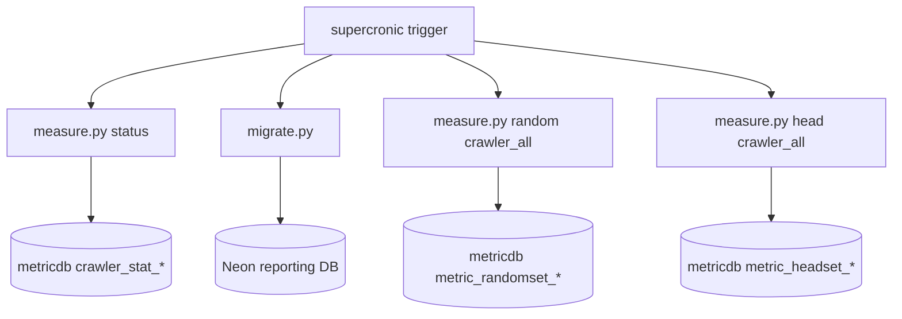

# Dockerfile and Runtime Operations - Full Technical Document

## 1. Container Build Design

Base image:

- `ubuntu:24.04`

Installed packages:

- `git`, `python3`, `python3-pip`, `python3-venv`, `curl`, `vim`
- [supercronic](https://github.com/aptible/supercronic) v0.2.51 (amd64), checked against its release SHA1

Project layout in container:

- Code copied to `/root/WebSearchEngine`
- Virtualenv at `/root/system-venv`
- Dependencies installed from `/root/WebSearchEngine/Metric/requirments.txt`
- Schedule at `/etc/supercronic/crontab`, copied from `Metric/deploy/crontab`. `supercronic -test` runs at build time, so a bad crontab fails the build.

## 2. Runtime Environment

- The image holds no secret. `SERPAPI_KEY` comes from `metric.env` at run time (`env_file` in `docker-compose.yml`). The file is `chmod 600` and kept out of git and the build context.
- supercronic does not clear the environment, so every job sees `SERPAPI_KEY`. Classic cron did: it gave jobs only `/etc/environment`, which held the Dockerfile's placeholder key, and batch 22 (2026-11-16) came out empty.
- `Metric/Query/SerpApi.py` is the only code that reads the key.
- `TZ=UTC`: the schedules below are UTC.

## 3. Scheduled Jobs

Configured in `Metric/deploy/crontab`:

- Hourly at minute 0:
  - `measure.py --test --measure status`
  - `migrate.py`

- Monthly on day 1 and 16 at 12:00:
  - `measure.py --create --strategy random --keywordNums 1000 --test --measure crawler_all`

- Monthly on day 1 and 16 at 18:00:
  - `measure.py --create --strategy head --keywordNums 1000 --test --measure crawler_all`

A `--create` run first checks the key and quota for free (`account.json`). A bad key or a trending fetch that fails for any geo makes the job exit non-zero and writes no batch. See [01-measure-py.md](./01-measure-py.md) 3.2.

## 4. Runtime Process Model

- `CMD ["supercronic", "-split-logs", "/etc/supercronic/crontab"]`: supercronic is PID 1.
- Job output and job failures, with their exit status, go to `docker logs metric`. The json-file log keeps 5 files of 50 MB.
- A job does not start again while its previous run is still going.
- On SIGTERM supercronic waits for running jobs. `stop_grace_period: 30m` gives a golden job time to finish.

## 5. Compose Services

`docker-compose.yml` defines `metric` (above: `network_mode: host`, `restart: unless-stopped`) and `metric_postgres`:

- Image: `postgres:16`
- User/password/db: `metric/metric/metricdb`
- Port mapping: `5433:5432`
- Data volume: `/data/metric:/var/lib/postgresql/data`

## 6. Operations Diagram



## 7. Deploy and Rollback (Host1)

Run from the WebSearchEngine clone on Host1. Avoid minute :00 of any hour, and 12:00–20:00 UTC on the 1st and 16th.

1. `git pull` to the commit to deploy.
2. Write the key once: `metric.env` with one line `SERPAPI_KEY=<key>`, then `chmod 600 metric.env`.
3. Build, and check the key and quota. This costs no search:
   ```bash
   METRIC_TAG=$(git rev-parse --short HEAD) docker compose build metric
   METRIC_TAG=$(git rev-parse --short HEAD) docker compose run --rm metric \
     sh -c 'cd /root/WebSearchEngine && /root/system-venv/bin/python3 Metric/getQuota.py'
   ```
4. Replace the running container. Keep the old one for rollback:
   ```bash
   docker stop metric && docker rename metric metric-prev
   METRIC_TAG=$(git rev-parse --short HEAD) docker compose up -d metric
   ```
5. Check: after the next full hour, `docker logs metric` shows the status job with `job succeeded`, and no `level=error` line.
6. Do not run `measure.py --create` to test a deploy. It writes a batch, and the next golden day reuses any non-empty batch under 14 days old instead of fetching a new one.
7. Rollback:
   ```bash
   docker compose stop metric && docker compose rm -f metric
   docker rename metric-prev metric && docker start metric
   ```
